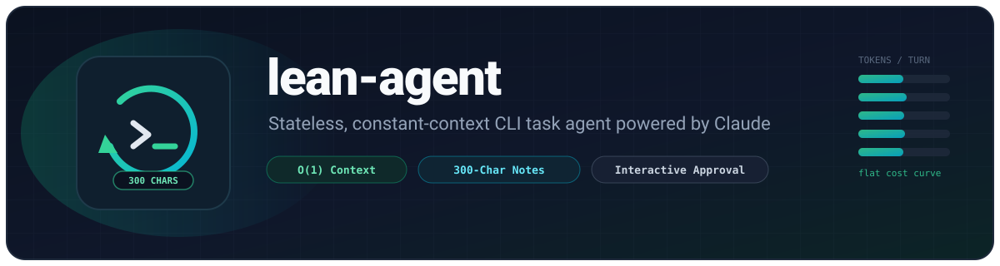
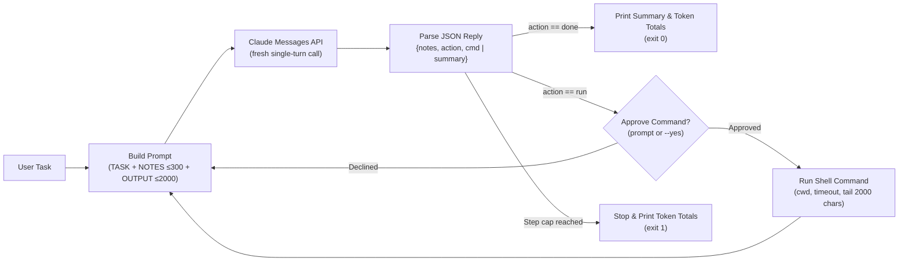

<p align="center">
  
</p>

<p align="center">
  <a href="https://www.python.org/downloads/"></a>
  <a href="https://docs.anthropic.com/"></a>
  <a href="https://github.com/aayushhzz/lean-agent/stargazers"></a>
  <a href="https://github.com/aayushhzz/lean-agent/issues"></a>
</p>

<p align="center">
  <a href="#how-it-works">How It Works</a> •
  <a href="#quick-start">Quick Start</a> •
  <a href="#usage">Usage</a> •
  <a href="#project-structure">Project Structure</a> •
  <a href="#testing">Testing</a> •
  <a href="docs/architecture.md">Architecture Docs</a>
</p>

---

**`lean-agent`** is a minimal, stateless CLI task agent powered by Claude. Instead of re-sending an ever-growing chat transcript on every turn, each step is a fresh, compact API call containing only:

1. **`TASK`** — the original natural-language goal
2. **`NOTES`** — a rolling scratchpad capped at **300 characters**, rewritten by the model each turn
3. **`OUTPUT`** — the last **2,000 characters** of the previous shell command's combined `stdout`/`stderr`

Because nothing large accumulates across turns, per-turn input tokens stay roughly constant regardless of how many steps a task takes.

## How It Works



For a deeper look at the prompt contract, error recovery, and programmatic API, see [docs/architecture.md](docs/architecture.md).

## Quick Start

### Prerequisites

- Python `>=3.10`
- An Anthropic API key (`ANTHROPIC_API_KEY`)

### Installation

```bash
git clone https://github.com/aayushhzz/lean-agent.git
cd lean-agent

python3 -m venv .venv
source .venv/bin/activate
pip install -e '.[dev]'
```

Export your Anthropic API key:

```bash
export ANTHROPIC_API_KEY="sk-ant-..."
```

## Usage

```bash
# Run with interactive command approval (default)
lean-agent "Find the largest Python file in this directory"

# Or invoke the module directly with a custom workdir and step limit
python3 lean_agent.py "Count TODOs in src/" --workdir ./my-repo --max-steps 10

# Auto-approve shell commands (use with caution)
lean-agent "Check git status and summarize modified files" --yes
```

### CLI Reference

| Option | Default | Description |
|---|---|---|
| `task` | *(required)* | Natural-language task for the agent to complete |
| `--workdir DIR` | `.` | Working directory for shell commands |
| `--model MODEL` | `claude-haiku-4-5` | Anthropic model ID |
| `--max-steps N` | `15` | Maximum number of agent steps before stopping |
| `--timeout S` | `120` | Per-command execution timeout in seconds |
| `--yes` | `False` | Execute shell commands without `run? [y/N]` confirmation |

**Exit codes:** `0` when the agent returns `"action": "done"`; `1` when `--max-steps` is reached without finishing.

## Configuration & Constants

Key runtime limits are defined at the top of [lean_agent.py](lean_agent.py):

| Constant | Value | Role |
|---|---|---|
| `DEFAULT_MODEL` | `"claude-haiku-4-5"` | Default Claude model ID |
| `NOTES_LIMIT` | `300` | Maximum characters retained in `notes` each turn |
| `OUTPUT_LIMIT` | `2000` | Tail characters retained from shell command output |
| `DEFAULT_TIMEOUT` | `120` | Default per-command timeout (seconds) |

You can also embed `lean-agent` programmatically via `run_agent(...)` in [lean_agent.py](lean_agent.py), which returns an `AgentResult` dataclass with `summary`, `completed`, `steps`, `notes`, `input_tokens`, and `output_tokens`.

## Project Structure

```text
lean-agent/
├── assets/
│   └── banner.svg             # Repository hero banner
├── docs/
│   └── architecture.md        # State loop, JSON protocol, and API notes
├── tests/
│   └── test_lean_agent.py     # Offline unit tests using a fake Anthropic client
├── lean_agent.py              # Single-file agent loop, shell runner, and CLI
├── pyproject.toml             # Package metadata and `lean-agent` console script
├── requirements.txt           # Core dependency (`anthropic>=0.40.0`)
└── README.md
```

## Testing

All tests run completely offline using a fake client (no API key or `anthropic` package required):

```bash
python3 -m unittest discover -s tests -v
```

Or with `pytest`:

```bash
pytest -v
```

---

<p align="center">
  Built by <a href="https://github.com/aayushhzz">aayushhzz</a> •
  <a href="https://github.com/aayushhzz/lean-agent/issues">Report an Issue</a> •
  <a href="https://github.com/aayushhzz">More Projects</a>
</p>
